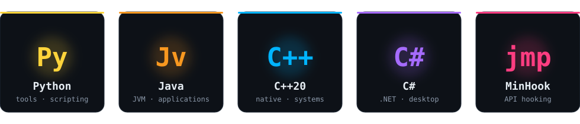

<div align="center">



</div>


### `// about`

```console
klotyzzx@dev:~$ whoami
developer: native code, tools, hooks

klotyzzx@dev:~$ cat now.txt
building ModsPort | learning low-level | shipping small useful tools

klotyzzx@dev:~$ cat mindset.txt
understand how it works, then build it better
```

I like figuring out how software works under the hood and turning that into practical tools.
From desktop utilities in Python to native code in C++20, I enjoy projects where the details matter.


### `// stack`

<div align="center">



</div>


### `// featured`

<a href="https://github.com/klotyzzx/ModsPort-FOR-STEAM">
  
</a>


### `// open to`

- collaborating on tools, utilities and interesting side projects
- talking about **Python**, **C++**, **C#**, **Java** and function hooking

<!--
### `// contact`
Add your own links here, then remove the comment markers:

[](https://t.me/YOUR_NICK)
[](https://discord.com/users/YOUR_ID)
-->

<div align="center">


</div>
